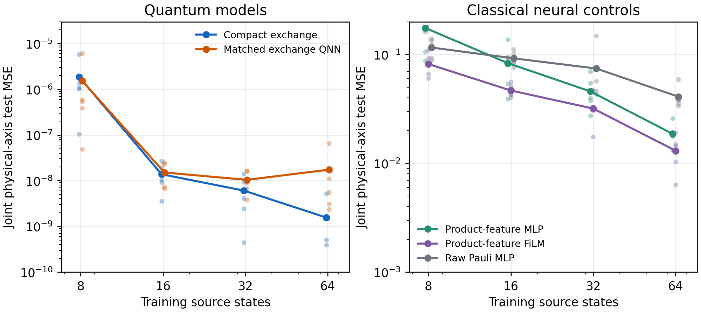

# Context-controlled exchange modulation

**A physics-first PyTorch + PennyLane project for repeatedly preparable quantum states.** Its primary question is how strongly a two-spin state responds to a chosen dephasing direction. A classical context selects source rotations and physical exchange coefficients; two independent quantum preparations produce measured port expectations and a prediction. The reusable implementation can also retain a quantum memory through multiple collisions.

The [website](https://zetanaut.github.io/quantum-exchange-modulation/) presents the [five-dataset QIP revision](docs/qip_revision.md), [trained decoherence application](docs/applications/decoherence.md), [physics applications](docs/physics.md), and a [guide to choosing a problem](docs/applications/choosing-a-problem.md). The source repository includes the model, checkpoints, exact examples, comparison records, and reproducible figures.


The retained memory obeys

$$
\omega' = a\omega+(1-a)\tau+i b[\omega,\tau],\qquad
\tau=V(c)\rho V(c)^\dagger,\qquad b^2\leq a(1-a).
$$

The repository contains a reusable state-valued network, a measured-observable regression head, a compact two-copy dephasing specialization, trained checkpoints, comparisons, and physics/application figures. The website explains the mathematics, code, learning protocol, hardware accounting, and deployment in detail.

## Start here

Use Python 3.12. The recorded environment uses CPU Torch 2.14.1 and PennyLane 0.45.1. The next command is for Linux CPU; on macOS, use the [standard PyPI installation in `docs/install.md`](docs/install.md#scientific-environment).

```bash
python3.12 -m venv .venv
source .venv/bin/activate
python -m pip install --upgrade pip
python -m pip install torch==2.14.1 --index-url https://download.pytorch.org/whl/cpu
python -m pip install -r requirements.txt
python -m pip install -e . --no-deps
python scripts/run_all.py
python examples/layer_forward.py
python examples/qip_revision_inference.py
python examples/train_streaming.py
```

To use the current validation-selected QIP model without another fit, run `python examples/qip_revision_inference.py --output /tmp/qem-qip-review`. It scores 512 new-state/held-out-axis pairs and also accepts a custom NPZ of two-qubit states and direction angles. The older `examples/pretrained_inference.py` remains as a historical API fixture. For your own task, specify a repeatable state source, contexts genuinely available at inference, independent target labels, and state-disjoint tests. See [training](docs/training.md) and [problem selection](docs/applications/choosing-a-problem.md).

[Installation](docs/install.md), [quickstart](docs/quickstart.md), [custom-data training](docs/training.md), and [reproduction commands](docs/reproduction.md) explain the inputs, outputs, and alternatives.

## What the evidence supports

The current directional-dephasing study uses **five independent datasets** and reserves both physical-axis caps `|n_x|>0.55` for testing. With 8 training states / 40 training pairs per dataset, the task-aligned compact exchange model reaches mean joint-test MSE **1.87e-6**, the matched two-copy QNN **1.53e-6**, the product-feature FiLM **0.0818**, and a fitted 36-feature Gram regression **1.82e-27**. Each budget also uses 96 validation labels. The exact Gram result and analytic collective estimator limit any learning or measurement advantage claim on this known target.

These results support a physical representation that can be trained from a task-aligned initialization. The [QIP revision page](docs/qip_revision.md) reports five-dataset variation, neutral-initialization failures, matched controls, and copy costs; the [full revision record](results/submission_revision/) retains every confirmation start and dataset. The older [results page](docs/evidence.md#historical-single-dataset-study) preserves the original single-dataset study with its axis-overlap limitation clearly marked.



The examples cover Bell/GHZ correlations hidden from single-qubit marginals, finite-time dephasing purity loss, the established sub-QFI sensitivity bound, and a three-spin Gibbs model. These examples have explicit scope labels: trained prediction, analytic transfer, exact diagnostic, or software integration. See [physics examples](docs/physics.md) and [references](docs/references.md).

The current manuscript's finite-time and one-state direction-map illustrations use a validation-selected new-protocol checkpoint; their data and scripts are in [`results/submission_revision/transfer_checks/`](results/submission_revision/transfer_checks/) and [`scripts/submission_transfer_refresh.py`](scripts/submission_transfer_refresh.py). The historical `results/physics_applications/` diagnostics remain for comparison, including the spectator-purity/QFI check. These are explanatory calculations, not new fits.

## Build the website

```bash
python -m pip install -r requirements-docs.txt
python scripts/prepare_site_assets.py
python -m mkdocs build --strict
python scripts/check_site.py
python -m mkdocs serve
```

Open the address printed by MkDocs. The static site contains 17 documentation pages, equations, 15 figure families, downloadable code and numerical evidence, and an interactive exchange-control and resource explorer. Python runs locally or in CI; the browser serves documentation and analytic controls. [Deployment](docs/deploy.md) explains the supplied GitHub Actions workflow.

## Repository map

| Directory | Contents |
|---|---|
| `qem/` | Quantum layers, predictor API, benchmark models, data generator, classical controls |
| `examples/` | Forward execution, frozen inference, supervised streaming training, physics demonstrations |
| `scripts/` | Training, learning curves, finite-shot comparisons, figures, resource and website tools |
| `data/` | The fixed benchmark and split metadata |
| `results/` | Recorded fits, checkpoints, predictions, CSV/JSON data, PNG/PDF/SVG plots |
| `verification/` | Independent matrix identities, actual PennyLane checks, resource certificate |
| `docs/` | Complete MkDocs source and mirrored download assets |
| `.github/workflows/` | Scientific verification and GitHub Pages build/deployment |

All reported experiments use exact simulator expectations for training. Finite-shot results concern inference after that training. Device noise, large-system scaling, and a broad quantum advantage remain research questions. Raw quantum preparations, measurement settings, and gate costs are documented separately from labeled-example counts.
