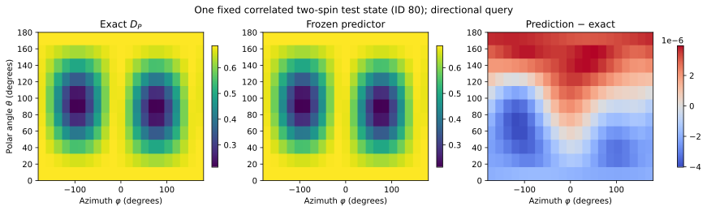

# Directional decoherence: a trained two-spin response

**Evidence status: trained physical-axis benchmark; finite-time analytic transfer.** The [current QIP revision](../qip_revision.md) reports five independent datasets and a split that excludes antipodal physical axes from training. The runnable checkpoint and numerical illustrations below belong to the earlier fixed-dataset study; its oriented-cap split overlaps physical training axes. Given repeatable preparations of a two-spin state, which local perturbation direction makes that state lose purity fastest? The context is the direction $\mathbf n$, not a hidden label describing how the state was made. The benchmark queries $P_{\mathbf n}=(\mathbf n\cdot\boldsymbol\sigma)\otimes I$ and predicts a dimensionless response $D_{P_{\mathbf n}}(\rho)$.

For a Hermitian involution $P=P^\dagger$, $P^2=I$, the dephasing model is

$$
\dot\rho=\gamma(P\rho P-\rho),\qquad
D_P(\rho)=\operatorname{Tr}(\rho^2)-\operatorname{Tr}(\rho P\rho P)
=\tfrac12\|[P,\rho]\|_{\rm HS}^2.
$$

Differentiating purity gives $d\operatorname{Tr}(\rho^2)/dt=2\operatorname{Tr}(\rho\dot\rho)=-2\gamma D_P(\rho)$. Thus $[P,\rho]=0$ means robustness **to this channel**. The response is a purity-loss susceptibility, not magnetization, energy, an entanglement measure, or a universal coherence monotone. A local $P$ can probe global correlations because $\rho P\rho P$ contains the full register state. The [physics derivation](../physics.md#1-directional-dephasing-response) and [correlation example](correlations.md) make that dependence explicit.

## From preparation to prediction

One benchmark example starts with a two-qubit density matrix $\rho\in\mathbb C^{4\times4}$ from a prepared state family and a pair of direction angles $(\theta,\varphi)$. The corresponding unit vector sets $P_{\mathbf n}$. The compact [trained circuit](../training.md#load-and-use-the-trained-specialization) prepares **two independent copies** of $\rho$, applies its learned conditional frame and a full-register exchange, then measures $P_{\mathbf n}$ on the two output ports. An affine Torch head maps their expectation values to $\widehat D$. The model does not receive the preparation-family parameters as features or call the target formula in its forward pass. The generic [state-valued network](../architecture.md#5-streaming-through-a-dnn) uses a different, stackable implementation.

Run the frozen predictor without fitting:

```bash
python examples/pretrained_inference.py --output /tmp/qem-pretrained-review
```

[Input/split manifest](../assets/data/benchmark.json) · [density-matrix dataset](../assets/data/benchmark.npz) · [checkpoint](../assets/results/torch_quantum/weights.npz) · [inference code](../assets/code/examples/pretrained_inference.py) · [recorded predictions](../assets/results/pretrained_inference/predictions.npz). This **historical** fixed study trains on 64 states with five contexts each, validates on 96 more pairs, and tests new states and an oriented direction cap. Its learning comparison is on the [historical evidence page](../evidence.md#learning-curves-count-complete-source-states). The matched two-copy QNN also fits the target; the known Gram formula is exact when its Pauli features are supplied.

## A directional map for one held-out state



[Open the full-size vector figure](../assets/figures/directional_response_map.svg) · [PDF](../assets/figures/directional_response_map.pdf) · [PNG](../assets/figures/directional_response_map.png).

This **historical exploratory grid** fixes `test_joint` state ID 80 (purity $0.7643$, connected $Z_1Z_2$ correlation $-0.2007$) and varies polar angle $\theta$ over 11 values and azimuth $\varphi$ over 21. The exact matrix response ranges from $0.2132$ to $0.6857$. The older validation-selected checkpoint has grid MSE $6.28\times10^{-12}$ and maximum absolute residual $4.03\times10^{-6}$. Five sampled directions also pass the actual PennyLane exchange circuit against the matrix reference. The [new-protocol map](../qip_revision.md#transfer-checks-and-source) uses a fresh checkpoint and is the one shown in the manuscript. Both maps illustrate one state, rather than a population test over directions.

[Grid CSV](../assets/results/physics_applications/directional_response_map.csv) · [checks and state/checkpoint hashes](../assets/results/physics_applications/manifest.json) · [regeneration script](../assets/code/scripts/physics_application_diagnostics.py). Regenerate with `python scripts/physics_application_diagnostics.py --output results/physics_applications_reproduction` and compare the result with the published record.

## Transfer through a known time law

For this generator alone, $\rho_T=[(1+e^{-2\gamma T})\rho+(1-e^{-2\gamma T})P\rho P]/2$, hence

$$
\operatorname{Tr}(\rho^2)-\operatorname{Tr}(\rho_T^2)
=\frac{1-e^{-4\gamma T}}{2}D_P(\rho).
$$

The [historical finite-time figure](../assets/figures/dephasing_transfer.svg) substitutes its older frozen $\widehat D_P$ into this known factor. Its 8,064 state–context–rate–time values use rates $\gamma=0.15,0.5,1.25$ and times $T\in[0,3]$ in the declared inverse-rate units. The manuscript instead uses the [fresh-protocol transfer check](../qip_revision.md#transfer-checks-and-source). The mixture weight of a Bell/GHZ state, when used elsewhere, is a different variable. The example can rank candidate preparations or vulnerable directions under a stated dephasing model; it has not learned an unknown channel. A noncommuting or nonunital generator needs a fresh derivation and test. [Historical CSV](../assets/results/physics_examples/dephasing_transfer.csv) · [script](../assets/code/examples/physics_examples.py).
