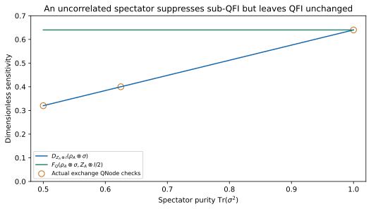

# Directional sensing and the established sub-QFI

**Evidence status: verified circuit identity and independent spectral/SLD calculations.** If a desired signal rotates a state through $\rho_\vartheta=e^{-i\vartheta P/2}\rho e^{i\vartheta P/2}$, the generator is explicitly $G=P/2$. The same $D_P$ used for dephasing is the established *sub-quantum Fisher information* for this unitary family [Cerezo et al.](https://arxiv.org/abs/2101.10144). The quantum Fisher information $F_Q$ quantifies the best local parameter sensitivity allowed by quantum measurements under the stated model [Paris](https://arxiv.org/abs/0804.2981).

For $\rho=\sum_i\lambda_i|i\rangle\langle i|$, omitting zero denominators,

$$
F_Q(\rho,P/2)=\frac12\sum_{i,j}
\frac{(\lambda_i-\lambda_j)^2}{\lambda_i+\lambda_j}|P_{ij}|^2,
\qquad D_P(\rho)=\frac12\sum_{i,j}(\lambda_i-\lambda_j)^2|P_{ij}|^2.
$$

For an off-diagonal pair $\lambda_i+\lambda_j\leq1$, so $D_P\leq F_Q$. Equality holds for pure states and for single-qubit states; mixed multiqubit states can show a gap. The existing [physics derivation](../physics.md#4-established-sub-qfi-as-a-parameter-sensitivity-diagnostic) and [261-case figure](../assets/figures/qfi_sensitivity.svg) include actual exchange QNodes and independent spectral and symmetric-logarithmic-derivative checks. [QFI CSV](../assets/results/physics_examples/qfi.csv) · [source](../assets/code/examples/physics_examples.py).

## An uncorrelated spectator changes the Hilbert–Schmidt response

For $\rho=\rho_A\otimes\sigma$ and $P=P_A\otimes I$, tensor-product traces factor:

$$
D_{P_A\otimes I}(\rho_A\otimes\sigma)
=D_{P_A}(\rho_A)\operatorname{Tr}(\sigma^2).
$$

The spectator is parameter independent, so its QFI contribution is zero and $F_Q(\rho_A\otimes\sigma,(P_A\otimes I)/2)=F_Q(\rho_A,P_A/2)$. The new deterministic diagnostic takes $\rho_A=(I+0.8X)/2$, $P_A=Z$, and $\sigma_s=(I+sZ)/2$. As spectator purity rises from $1/2$ to $1$, the response rises from $0.32$ to $0.64$; QFI stays $0.64$. Matrix identities and three actual exchange QNodes agree within the stated tolerance.

[Open the full-size vector figure](../assets/figures/spectator_purity.svg) · [PDF](../assets/figures/spectator_purity.pdf) · [PNG](../assets/figures/spectator_purity.png).

[CSV](../assets/results/physics_applications/spectator_purity.csv) · [checks and environment](../assets/results/physics_applications/manifest.json) · [reproduction script](../assets/code/scripts/physics_application_diagnostics.py). Run `python scripts/physics_application_diagnostics.py --output results/physics_applications_reproduction`. This purity dependence matters when comparing different temperatures or register sizes. Dividing by purity would define another quantity; it should not silently retain the same sub-QFI bound name.

A large response is useful when $P/2$ encodes the **desired signal** and potentially harmful when it represents **unwanted noise**. A learned or finite-shot $\widehat D$ can guide directional screening or act as a surrogate objective. To report a certified numerical lower bound, include an error allowance on the estimate. No result here identifies an optimal measurement, computes a multiparameter QFI matrix, or demonstrates improved sensing hardware.
