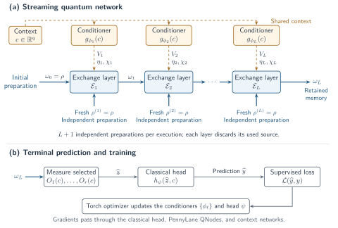
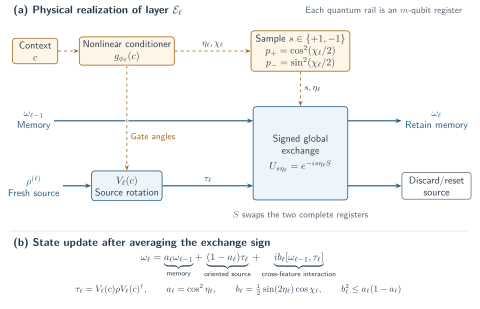

# Architecture: conditional modulation of quantum hidden states

Context-controlled exchange modulation is a state-valued layer for quantum data. A classical context network controls quantum gates; those gates couple the current quantum representation to an independently prepared input. The output remains a density operator that can enter another quantum layer.

The repository provides a general streaming implementation and a task-specialized benchmark:

| Implementation | Role | Output |
|---|---|---|
| `ContextExchangeLayer` and `StreamingExchangeNetwork` | General nonlinear conditioner and stackable quantum memory | A density matrix in simulation |
| `StreamingObservableRegressor` | Streaming backbone with selected Pauli measurements and an affine head | A real prediction tensor |
| `TorchQuantumModel("joint_exchange")` | The trained, 25-parameter, one-collision specialization | Two port expectations, their correlation, and an affine prediction |

The distinction matters when interpreting results. The [evidence page](evidence.md) reports trained benchmark models. The generic stack has separate physical-state, gradient, and small training-path checks. See the [state-valued source](assets/code/qem/layers.py) and [regressor wrapper](assets/code/qem/predictors.py) for their interfaces.



## 1. A hidden state carries the features

For an input on \(m\) qubits, write \(d=2^m\). The hidden representation after layer \(\ell\) is a density matrix \(\omega_\ell\): it is positive semidefinite and has unit trace. Its operator coordinates are

$$
h_{\ell,\mu}=\operatorname{Tr}(F_\mu\omega_\ell),
$$

where the \(F_\mu\) can be Pauli strings. These coordinates include coherences and correlations between qubits. The physical memory carries that information without measuring every coordinate between layers.

Classical [FiLM](https://arxiv.org/abs/1709.07871) changes numerical features through context-dependent scales and offsets. Here, context selects a source-state orientation and a physically constrained interaction. This gives feature modulation an operational meaning when the features belong to noncommuting observables.

The conditioner itself is classical. The quantum processing occurs in the rotation, exchange interaction, and retained quantum memory. Quantum-valued context registers would require a separate design and access model.

## 2. The exchange block

Prepare a memory state \(\sigma\) and an independent source state \(\rho\). Apply a context-controlled unitary to the source:

$$
\tau=V(c)\rho V(c)^\dagger.
$$

Couple the equal-size registers with the full register SWAP \(S\), using

$$
U_\eta=e^{-i\eta S}=\cos\eta\,I-i\sin\eta\,S.
$$

After discarding the source output, a coherent exchange produces

$$
\operatorname{Tr}_{B}\!\left[
U_\eta(\sigma\otimes\tau)U_\eta^\dagger
\right]
=\cos^2\eta\,\sigma+\sin^2\eta\,\tau
+i\cos\eta\sin\eta[\sigma,\tau].
$$

The complete coefficient family used here is

$$
F_{a,b}(\sigma,\tau)
=a\sigma+(1-a)\tau+ib[\sigma,\tau],
\qquad
a=\cos^2\eta,\quad
b=\tfrac12\sin(2\eta)\cos\chi.
$$

Choose \(U_\eta\) with probability \(\cos^2(\chi/2)\) and \(U_{-\eta}\) otherwise. The average retained state is exactly \(F_{a,b}\). A physical shot chooses one sign and consumes one prepared pair; averaging two exact simulator branches does not imply four physical copies per shot.



The allowed coefficients satisfy

$$
0\leq a\leq1,\qquad b^2\leq a(1-a).
$$

This is the sharp region that yields a density matrix for every pair of inputs. Its boundary comes from coherent exchange; mixtures of opposite signs fill its interior. The state-addition primitive is established [partial-SWAP prior work](https://arxiv.org/abs/1503.04213).

## 3. What is nonlinear?

For fixed source \(\tau\), the retained output is linear in \(\sigma\). The physical channel is always linear on its full joint input.

For self-modulation, the source supplies a second independent preparation of the same unknown state:

$$
\sigma=\rho,\qquad \tau=V(c)\rho V(c)^\dagger.
$$

The commutator now contains products of entries of \(\rho\). The resulting feature map is quadratic in the state description because its input is \(\rho\otimes\rho\). No unknown state is cloned.

For qubits, let \(\sigma=(I+\mathbf r\cdot\boldsymbol\sigma)/2\) and \(\tau=(I+\mathbf t\cdot\boldsymbol\sigma)/2\). Then

$$
\mathbf r'=a\mathbf r+(1-a)\mathbf t-b\,\mathbf r\times\mathbf t.
$$

The cross product mixes several coordinates. For example, rotate a fresh copy by \(\pi/2\) around \(Z\), so \(\mathbf t=(-y,x,z)\). With \(a=b=1/2\),

$$
z'=z-\tfrac12(x^2+y^2).
$$

A measured output coordinate therefore contains a quadratic combination of input coherences. For an input along \(+X\), the retained Bloch vector is \((1/2,1/2,-1/2)\), a valid mixed state.

This quantum-input dependence is separate from a nonlinear context-to-angle map. A conditioner can combine several classical variables even when the unknown-state processing remains linear in one argument.

## 4. The nonlinear context conditioner

Each generic layer owns its own multilayer perceptron:

$$
\mathbf u_\ell
=W_{\ell,2}\tanh(W_{\ell,1}c+\mathbf t_{\ell,1})
+\mathbf t_{\ell,2}.
$$

For \(q\) context variables and default hidden width \(h=16\), the network has dimensions \(q\to h\to p+2\), where \(p=3m+(m-1)\). Its outputs control:

| Outputs | Quantum role |
|---|---|
| First \(3m\) angles | One Euler rotation on each source qubit |
| Next \(m-1\) angles | Nearest-neighbor \(ZZ\) rotations |
| \(\eta\) | Interpolation and available commutator strength |
| \(\chi\) | Relative probability of the exchange signs |

The implementation uses

$$
\boldsymbol\alpha=\pi\tanh(\mathbf u_{1:p}),\quad
\eta=\tfrac\pi2\operatorname{sigmoid}(u_{p+1}),\quad
\chi=\pi\operatorname{sigmoid}(u_{p+2}).
$$

This enforces physicality throughout optimization. The orientation \(V(c)\) determines which operator components interact. The scalar gains control their relative contribution; they do not provide arbitrary independent offsets for every Pauli feature.

## 5. Streaming through a DNN

Initialize the memory with \(\omega_0=\rho\). Layer \(\ell\) receives a fresh preparation \(\rho^{(\ell)}\) of the same input:

$$
\begin{aligned}
\tau_\ell&=V_\ell(c)\rho^{(\ell)}V_\ell(c)^\dagger,\\
\omega_\ell&=F_{a_\ell,b_\ell}(\omega_{\ell-1},\tau_\ell).
\end{aligned}
$$

The superscript labels a preparation, not a matrix power. Keep the memory, discard the used source, and inject another independent source at the next layer. A depth-\(L\) execution consumes \(L+1\) preparations. For two layers, the first output already contains learned features when it meets the third raw preparation.

A deterministic expectation from \(k\) copies has the form

$$
f(\rho,c)=\operatorname{Tr}[M(c)\rho^{\otimes k}],
$$

so its degree in \(\rho\) is at most \(k\). Streaming depth can raise the degree to at most \(L+1\). Recursively preparing two copies of every hidden state would instead cost \(2^L\) raw preparations in the direct construction. [Quantum-data re-uploading](https://arxiv.org/abs/2509.18530v6) is a close precedent for repeated native-state access.

An optional trainable memory unitary could replace \(\omega_{\ell-1}\) by \(B_\ell\omega_{\ell-1}B_\ell^\dagger\) before a collision. The supplied generic module uses \(B_\ell=I\).

## 6. Use the state-valued API

Run this after installing the package, from the repository root:

```python
import numpy as np
import torch
from qem.layers import StreamingExchangeNetwork

torch.set_default_dtype(torch.float64)
torch.set_num_threads(1)
data = np.load("data/benchmark.npz")
rho = torch.tensor(data["train_rho"][:4], dtype=torch.complex128)
context = torch.tensor(data["train_context"][:4])

network = StreamingExchangeNetwork(
    n_qubits=2, context_dim=3, hidden=16, depth=2
)
hidden_state = network(rho, context)
print(hidden_state.shape)               # torch.Size([4, 4, 4])
print(network.copies_per_execution)      # 3
```

| Quantity | Simulator shape |
|---|---|
| Input, memory, returned state | \(B\times d\times d\) |
| Classical context | \(B\times q\) |
| Conditioner outputs | \(B\times(p+2)\) |
| Joint state inside one block | \(B\times d^2\times d^2\) |

The caller attaches a measurement rule and prediction head. The pinned PennyLane mixed-state backend requires Torch’s float64 default for accurate Kraus execution. Each batch example uses a public, unbatched QNode, preserving gradients through the returned density matrix.

These tensors describe simulation. Hardware would retain a quantum memory register between collisions; it would not export a density matrix, perform tomography, and reconstruct it for free.

## 7. The compact trained specialization

The benchmark uses a learned directional frame,

$$
V(c)=A(c)WA(c)^\dagger,
$$

on a fresh two-qubit input. Four parameters learn the scales and offsets of the Euler-frame angles. Sixteen parameters specify the internal Pauli rotations. Two context-independent exchange parameters, two head weights, and one bias give **25 trainable parameters**.

The terminal circuit measures both ports before discard. Its API returns `heads`, `correlation`, and `prediction`. The head is an affine combination of the two means; the correlation is used for correct uncertainty accounting, not as an additional predictor input.

This small parameter count encodes a strong directional and quadratic prior. It should be assessed alongside the 28-parameter QNN with the same exchange primitive and the exact six-feature classical Gram model. [Saved results](assets/results/summary.json) show that both are essential comparisons.

## 8. Gate cost and structural limits

Full register exchange is

$$
e^{-i\eta S_{AB}},
\qquad
S_{AB}=\prod_j S_{A_jB_j}.
$$

It generally differs from a product of local partial swaps. The public `global_exchange` helper supports an exact matrix gate and a controlled-SWAP construction with a clean ancilla. For two-qubit input registers, the verified construction uses four Fredkin gates, or 32 CNOTs in the specified decomposition; four additional two-qubit Pauli rotations give a 40-CNOT upper construction. Preparation, routing, and noise add costs. See the [resource certificate](assets/verification/resource_certificate.json).

A self-rotated block fixes the maximally mixed state and cannot increase input purity. Its nonlinear term vanishes for commuting input and rotated-source states. These constraints guide useful task choices: exchange changes how quantum information is represented and measured, while [training](training.md) and [physical examples](physics.md) determine whether that change helps.
