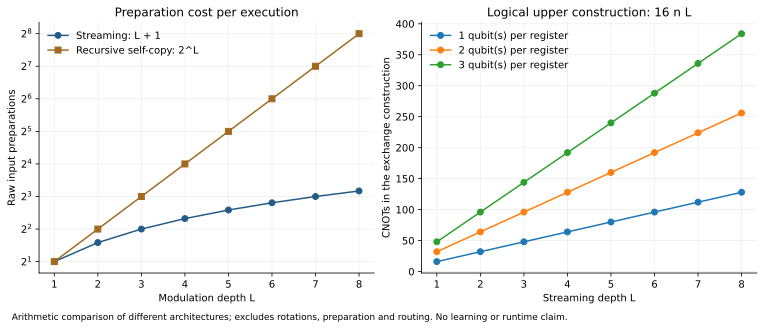

# Explore the controls and resources

The exchange coefficients satisfy a physical constraint. Changing the context network changes which point in this region the layer uses. The explorer below evaluates the exact gate parameterization; it runs simple arithmetic in your browser.

$$
a=\cos^2\eta,\qquad b=\tfrac12\sin(2\eta)\cos\chi,\qquad
(a-\tfrac12)^2+b^2\leq\tfrac14.
$$

## Exchange controls

<div class="qem-explorer" id="exchange-controls">
  <label for="eta-control">Exchange angle η: <output data-value="eta">45°</output></label>
  <input id="eta-control" name="eta" type="range" min="0" max="90" value="45" step="1">
  <label for="chi-control">Sign-mixture angle χ: <output data-value="chi">45°</output></label>
  <input id="chi-control" name="chi" type="range" min="0" max="180" value="45" step="1">
  <svg viewBox="0 0 450 270" role="img" aria-label="Allowed disk of memory weight a and commutator gain b">
    <circle cx="225" cy="130" r="100" fill="#e4eff7" stroke="#245b85" stroke-width="2"/>
    <path d="M100 130H350M125 245V15" stroke="#667d8e" stroke-width="1"/>
    <text x="353" y="136" fill="#304d60">a</text><text x="113" y="14" fill="#304d60">b</text>
    <text x="116" y="150" fill="#304d60">0</text><text x="219" y="150" fill="#304d60">0.5</text><text x="321" y="150" fill="#304d60">1</text>
    <text x="88" y="35" fill="#304d60">0.5</text><text x="81" y="233" fill="#304d60">−0.5</text>
    <circle id="coefficient-marker" cx="225" cy="59.3" r="6" fill="#b27116" stroke="white" stroke-width="2"/>
  </svg>
  <div class="qem-values">
    <div class="qem-value"><span>Memory weight a</span><output data-value="a">0.5000</output></div>
    <div class="qem-value"><span>Commutator gain b</span><output data-value="b">0.3536</output></div>
    <div class="qem-value"><span>Probability of +η</span><output data-value="pplus">0.8536</output></div>
    <div class="qem-value"><span>Probability of −η</span><output data-value="pminus">0.1464</output></div>
  </div>
  <p class="note">The sliders use degrees for readability. The Python implementation uses radians. This is an analytic explorer, not a hosted quantum simulation.</p>
</div>

At η = 0 the memory passes through. At η = 90° the rotated source replaces it. The largest commutator magnitude at a given memory weight occurs when one exchange sign is used exclusively. Setting χ = 90° averages the two signs equally and removes the commutator term from the retained state. The [architecture guide](architecture.md) connects these controls to multivariable operator features and the nonlinear Torch conditioner.

## Preparation and gate budget

A depth-$L$ streaming execution retains one memory register and consumes $L$ fresh source preparations. Repeating for $N$ shots in each of $s$ separately measured settings requires $(L+1)Ns$ source preparations. The example below assumes one independently repeated execution for every shot and setting.

<div class="qem-explorer" id="resource-calculator">
  <div class="qem-values">
    <div><label for="n-control">Qubits per register</label><input id="n-control" name="qubits" type="number" min="1" max="20" value="2"></div>
    <div><label for="l-control">Streaming depth</label><input id="l-control" name="depth" type="number" min="1" max="100" value="2"></div>
    <div><label for="shots-control">Shots per setting</label><input id="shots-control" name="shots" type="number" min="1" value="1000"></div>
    <div><label for="settings-control">Readout settings</label><input id="settings-control" name="settings" type="number" min="1" value="3"></div>
  </div>
  <div class="qem-values">
    <div class="qem-value"><span>Preparations per execution</span><output data-value="perexecution">3</output></div>
    <div class="qem-value"><span>Total inference preparations</span><output data-value="copies">9,000</output></div>
    <div class="qem-value"><span>Data qubits + exchange ancilla</span><output data-value="qubits">5</output></div>
    <div class="qem-value"><span>Fredkins per execution</span><output data-value="fredkin">8</output></div>
    <div class="qem-value"><span>Exchange CNOT upper construction</span><output data-value="cnot">64</output></div>
  </div>
  <p class="note">Gate counts describe the verified logical phase-kickback construction. They exclude source preparation, rotations, connectivity routing, readout, labels and gradient circuits. Analog implementations can have different costs.</p>
</div>



The recursive self-copy curve uses a different architecture, in which both inputs to each subsequent block must be prepared independently. Its preparation growth differs from streaming. This arithmetic comparison does not establish equal expressive power or equal learning performance.

Reproduce the resource calculation and static plot:

```bash
python scripts/resource_estimate.py --n-qubits 2 --depth 2 --shots 1000 --settings 3 --plot
```

[Download the calculator script](assets/code/scripts/resource_estimate.py) and [recorded calculation](assets/results/resources/metrics.json).
