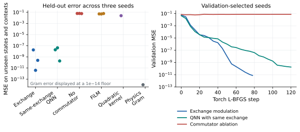
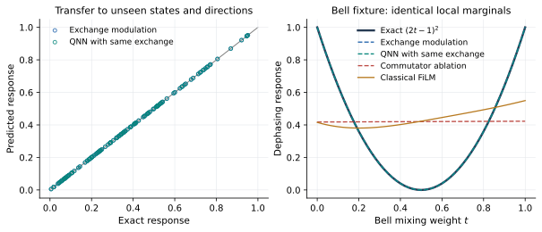
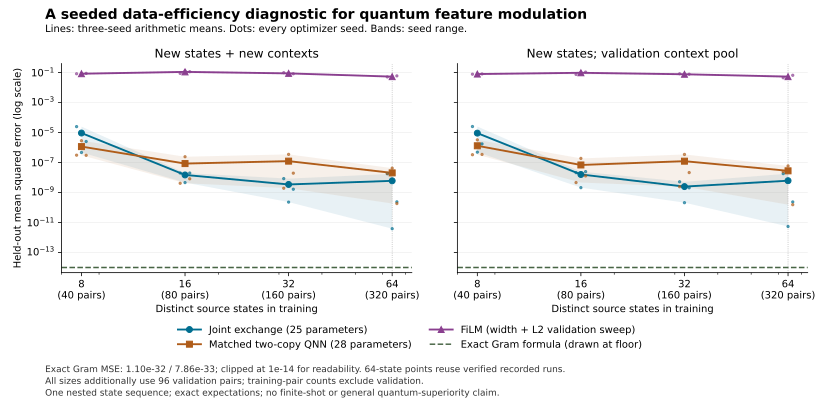
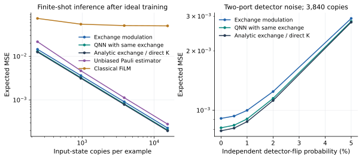

# Evidence, comparisons, and the meaning of advantage

## Current five-dataset QIP revision

The [current validation study](qip_revision.md) reserves **physical axes**, including antipodes, for testing and repeats the protocol on five independently generated datasets. At 64 training states, mean joint-test MSE is $1.56\times10^{-9}$ for the task-aligned compact exchange model, $1.75\times10^{-8}$ for a matched exchange QNN, and approximately machine precision for a fitted 36-feature Gram regression. The [full result summary](assets/results/submission_revision/summary.json), [frozen protocol](assets/results/submission_revision/protocol.json), and [manuscript source](https://github.com/zetanaut/quantum-exchange-modulation/blob/main/paper/qip/quantum_exchange_modulation_paper.tex) support these values.

At 3,840 source copies for one query, direct $K_P$ has mean expected MSE $8.19\times10^{-4}$ and the learned compact circuit $8.63\times10^{-4}$. A reusable Pauli record overtakes context-specific collective queries between two and three queries under the specified total-copy allocation. The [QIP revision page](qip_revision.md#copies-and-repeated-queries) explains the access rules and limitations.

## Historical single-dataset study

The sections below preserve the original fixed-dataset study for provenance. Its oriented $n_x>0.55$ holdout cap contained physical axes whose antipodes appeared in training, so its context generalization figures should not be treated as evidence for unseen physical axes. Its checkpoint, illustrations, and numerical records remain useful for software regression and for comparing the revised protocol. The current manuscript uses the five-dataset records above for its primary claims.

The historical two-qubit experiment shows that the compact exchange model can fit the analytic response with very small error under its split. It also shows why that success needs strong controls: a QNN supplied with the same exchange operation learns the target, and a six-feature classical model with the exact physical contraction reaches floating-point precision.

## Application and resource evidence matrix

| Claim or use | Observed evidence | Strongest relevant comparison | Resource or scope |
|---|---|---|---|
| Physical quadratic feature $D_P$ | Exact two-copy port identity, independent matrices and actual QNodes; [checks](assets/verification/theory_results.json) | Direct collective $K_P$ has the same ideal grouped statistics; known Gram formula is exact when its Pauli features are supplied | Two independent source preparations per joint shot; representation result, not a hardware speedup |
| Held-out dephasing prediction | [Primary summary](assets/results/summary.json) and [state-budget curve](assets/results/learning_curve/summary.csv) | Matched same-exchange QNN also fits and is better at eight states; full FiLM width/regularization sweep | 8/16/32/64 training states, 3 optimizer seeds, plus 96 validation pairs at every budget; one fixed nested dataset |
| Inference copies | [Finite-shot metrics](assets/results/finite_shot/metrics.json) for frozen weights | Direct $K_P$, target-informed Pauli allocation, measured FiLM features; grouping and shadow records can change costs | Specific settings/allocations and raw-copy budgets, separate from training labels |
| Bell/GHZ correlation response | [82 circuit cases](assets/results/physics_examples/correlation.csv) | Global $X^{\otimes m}$ parity product has **lower variance** than exchange on this family | Exact prescribed circuit; no trained correlation model or entanglement certification |
| Finite-time dephasing and sub-QFI | [Transfer record](assets/results/physics_examples/dephasing_transfer.csv), [QFI record](assets/results/physics_examples/qfi.csv) | Known analytic decay and established sub-QFI/QFI formulae | Frozen predictor reuse and exact diagnostic, not learned unknown dynamics or sensing hardware |
| Three-spin Gibbs response | [Field/temperature scan](assets/results/physics_examples/spin_gibbs.csv) | Independent matrices and a distinct local-pair-swap circuit | Three-spin exact identity, not a trained many-body scaling result |
| Logical implementation | [Resource certificate](assets/verification/resource_certificate.json) | Alternative direct observable and local-basis estimators | Specified full-register construction; preparation, routing, noise, and wall time excluded |

The new [direction map](applications/decoherence.md#a-directional-map-for-one-held-out-state) and [spectator-purity check](applications/metrology.md#an-uncorrelated-spectator-changes-the-hilbertschmidt-response) are explanatory diagnostics. They add no training fits. Reusing a measured Pauli or classical-shadow record over many contexts can amortize preparation cost; a fresh collective query consumes new copies. The current comparisons do not establish a general quantum computational, shot, or hardware advantage.

The useful conclusion is a working physical construction with an effective task prior. The current experiments do not establish a significant general quantum advantage.

## The held-out experiment

The target is \(D_P(\rho)=\operatorname{Tr}\rho^2-\operatorname{Tr}(\rho P\rho P)\). Training uses 320 state–context pairs from 64 source states. The principal test contains 128 pairs from 32 further states and the held-out cap \(n_x>0.55\). Additional splits isolate state and context transfer. The [manifest](assets/data/benchmark.json) specifies the source families and split sizes.

The primary learned quantum models and Torch FiLM use seeds 17, 31, and 73. Displayed checkpoints and seeds are selected by validation, never by test error. The following values come from [summary.json](assets/results/summary.json); [summary.csv](assets/results/summary.csv) provides a compact download.

| Model | Parameters or coefficients | Validation-selected joint-test MSE | Median joint-test MSE across seeds |
|---|---:|---:|---:|
| Exchange modulation | 25 | \(3.87\times10^{-12}\) | \(2.40\times10^{-10}\) |
| QNN with the same exchange | 28 | \(1.85\times10^{-10}\) | \(1.89\times10^{-8}\) |
| Commutator ablation | 25 stored, 24 active | \(6.27\times10^{-2}\) | \(6.19\times10^{-2}\) |
| Classical Torch FiLM | 277 | \(4.98\times10^{-2}\) | \(5.11\times10^{-2}\) |
| Quadratic product kernel | 320 training coefficients | \(2.49\times10^{-2}\) | One deterministic fit |
| Physics-informed Gram features | 6 | \(5.32\times10^{-32}\) | One exact calibration |

Parameter counts are descriptive, not equal compute budgets. Kernel coefficients and neural-network parameters also have different computational roles.

The exchange model’s selected RMSE is \(1.97\times10^{-6}\); the matched QNN’s is \(1.36\times10^{-5}\). Both are small on a target in \([0,1]\). Differences between extremely small simulator errors do not establish a practically useful separation.

The ablation removes the commutator while preserving its chosen port-mean head. Its failure supports the role of quadratic input features in that restricted architecture. It is not a theorem that every quantum circuit or classical nonlinear predictor without this specific term must fail.

Additional [classical reference fits](assets/results/classical/summary.json) include context-only regression with joint-test MSE \(0.0590\), affine state features with \(0.0661\), and an RBF kernel with \(0.0552\). They help locate the difficulty, but the exact Gram model is the decisive classical control for representability.

## Why the Gram comparator is exact

Expand a two-qubit state in Pauli coefficients \(r_{ab}\). For each second-qubit index \(b\in\{I,X,Y,Z\}\), let

$$
\mathbf r_b=(r_{xb},r_{yb},r_{zb})^\mathsf T,\qquad
G=\sum_b\mathbf r_b\mathbf r_b^\mathsf T.
$$

Then, for \(P=(\mathbf n\cdot\boldsymbol\sigma)\otimes I\),

$$
D_P(\rho)=\tfrac12\left[\operatorname{Tr}G-\mathbf n^\mathsf T G\mathbf n\right].
$$

Only six independent entries of \(G\) are needed. A linear head on the corresponding context-contracted features represents the target exactly. Its MSE near \(10^{-32}\) indicates floating-point agreement, not a meaningful experimental accuracy beyond machine precision.

This comparator has strong prior knowledge. So do the analytic exchange and direct-\(K_P\) constructions. Showing them alongside learned models reveals whether an apparent gain is due to discovering a useful representation or already supplying the target’s structure.

Ideal Pauli features are free inputs only in the simulation comparison. Their physical estimation cost is assessed separately.

## Learning curves count complete source states

The study varies complete training source states: 8, 16, 32, and 64, with five context pairs per state. One declared nested sequence is balanced across the three source families. Each size uses three optimizer seeds and the same fixed validation and test sets. The classical FiLM configuration sweep is repeated at each size.

The 64-state endpoint reuses verified matching primary fits; smaller budgets are separate training runs. The [protocol](assets/results/learning_curve/protocol.json) and [full metrics](assets/results/learning_curve/metrics.json) identify this provenance. All seeds and aggregate values are retained in [summary.csv](assets/results/learning_curve/summary.csv). Every point additionally uses 96 validation pairs; the axis is a training-data budget, not the total labeled data consumed.

| Training states | Training pairs | Exchange mean MSE | Same-exchange QNN mean MSE | FiLM mean MSE |
|---:|---:|---:|---:|---:|
| 8 | 40 | \(9.31\times10^{-6}\) | \(1.16\times10^{-6}\) | \(0.0839\) |
| 16 | 80 | \(1.49\times10^{-8}\) | \(8.54\times10^{-8}\) | \(0.1113\) |
| 32 | 160 | \(3.46\times10^{-9}\) | \(1.24\times10^{-7}\) | \(0.0882\) |
| 64 | 320 | \(6.05\times10^{-9}\) | \(2.05\times10^{-8}\) | \(0.0537\) |

The matched QNN has the lower mean error at eight states. The structured exchange model has the lower mean at the other sampled budgets; neither curve is guaranteed to improve monotonically. Both benefit from the supplied collective primitive and directional geometry. The curve's exact Gram line is an untrained known-physics oracle, whereas the primary table reports a fitted six-coefficient version.

All 96 configured runs completed, including 72 fresh fits and 24 verified endpoint reuses. The [audit](assets/results/learning_curve/audit.json) reconstructs 576 reported MSE values from saved predictions with zero discrepancy.

A lower curve supports better performance under this specific training protocol. Seed ranges describe optimizer variability for one nested dataset, not a confidence interval over independently sampled state populations. The exact Gram floor remains visible. When an error is plotted at a display floor, that convention is stated; it does not mean the underlying error is zero.

## Finite-copy inference

Training uses exact labels and exact expectations. The finite-shot study evaluates already-trained models with total source-copy budgets of 240, 960, 3,840, and 15,360 per example.

At 3,840 source copies per example:

| Protocol | Expected joint-test MSE | Calculation |
|---|---:|---|
| Analytic exchange / direct \(K_P\) | \(7.87\times10^{-4}\) | Exact moments |
| Learned QNN with the same exchange | \(8.15\times10^{-4}\) | Exact affine-head moments |
| Learned exchange modulation | \(9.09\times10^{-4}\) | Exact affine-head moments |
| Target-informed Pauli estimator | \(1.13\times10^{-3}\) | Eight independent settings, unbiased squares |
| Separate-branch exchange | \(1.68\times10^{-3}\) | Two separately sampled branches |
| Classical Torch FiLM | \(5.09\times10^{-2}\) | 512 Monte Carlo replicates |
| Commutator ablation | \(6.28\times10^{-2}\) | Exact affine-head moments |

The FiLM Monte Carlo standard error is \(6.78\times10^{-5}\) at this budget. See [finite-shot metrics](assets/results/finite_shot/metrics.json) for all budgets, biases, variances, and uncertainty metadata.

The learned exchange model improves on the particular eight-setting Pauli allocation at this dataset and budget. The same-exchange QNN and analytic collective estimator perform better still. Measurement grouping, adaptive allocation, other classical estimators, and context reuse can change the comparison. These curves are protocol-specific evidence, not a lower bound on classical sample complexity.

### Correctly use the port covariance

For head weights \(w_A,w_B\), port means \(z_A,z_B\), and correlation \(q=\mathbb E[st]\), the per-shot variance is

$$
v=w_A^2(1-z_A^2)+w_B^2(1-z_B^2)
+2w_Aw_B(q-z_Az_B).
$$

With \(N=C/2\) joint shots, expected squared prediction error is squared bias plus \(v/N\). Treating the two port means as independently sampled changes both the variance and resource accounting.

For the analytic response, the estimator \(t-s\) has variance

$$
\operatorname{Var}(\widehat D)
=\frac{4(1-m^2)-2D^2}{C}.
$$

It has the same grouped distribution as measuring \(K_P=(I-P\otimes P)S\). The two-port refinement saves preparations relative to separate branches; it does not improve on direct measurement of that observable.

### What the classical shot protocols measure

The target-informed estimator uses two directions perpendicular to the query axis and four Pauli factors on the second qubit, giving eight independently allocated observables. If one expectation is \(\mu\), its squared mean is estimated without bias by

$$
\widehat{\mu^2}
=\frac{(\sum_{j=1}^{N}x_j)^2-N}{N(N-1)}.
$$

FiLM instead receives fifteen independently estimated nonidentity Pauli features. Neither allocation claims optimal grouping or shot-aware retraining. The [Bell/GHZ example](physics.md) explicitly demonstrates a family where a simple global-Pauli product estimator has lower variance than exchange.

## Noise and compiled resources

The saved detector study flips each terminal port sign independently. At a 5% flip probability and 3,840 copies, the selected exchange model’s expected MSE is \(0.002924\), compared with \(0.000909\) without those flips. No mitigation is applied. This is a readout-error model for the two-port implementation, not a gate-noise simulation or a universal model for every apparatus measuring \(K_P\).

The [resource certificate](assets/verification/resource_certificate.json) verifies a full global-exchange construction, including complex phases. For two-qubit registers it gives 32 CNOTs for exchange and 40 after four additional weight-two Pauli rotations. This is an upper construction under a specified logical gate basis, with preparation, routing, and error correction excluded. It is not an optimal compiled count or a hardware runtime measurement.

## What has been established

| Evidence | Supported conclusion | Further work |
|---|---|---|
| Exact map, coefficient, gate, and gradient checks | The implemented operation is consistent with the physical construction | Hardware implementation and noise characterization |
| Seeded held-out benchmark | The structured one-collision model fits this task | Broader task families and independent data resampling |
| Same-exchange QNN and exact Gram comparison | Success is compatible with a strong primitive and task prior | Isolate a useful benefit of the proposed parameter ties |
| Copy-counted inference curves | Particular estimator protocols have different costs | Optimized measurement allocations and shot-trained models |
| Larger analytic physical examples | The operation and identities extend beyond the fitted two-qubit setting | Supervised learning on larger registers |

The next convincing result would identify a task family and access regime where the architecture offers a reproducible practical gain after strong collective and measured-feature comparisons. The present package supplies the constructions, code, and records needed to test that question.
