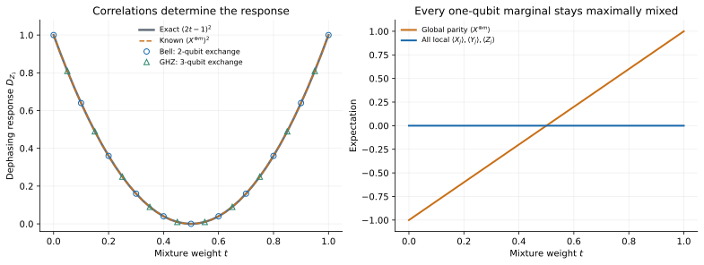
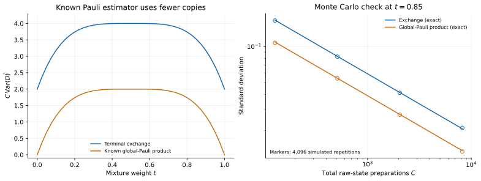
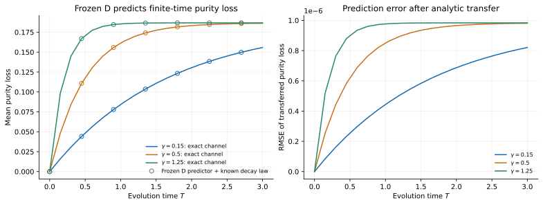
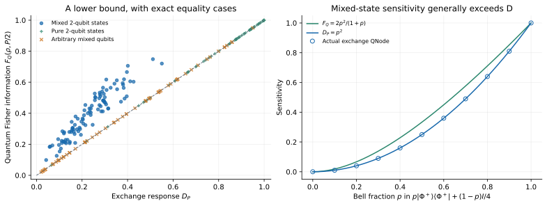
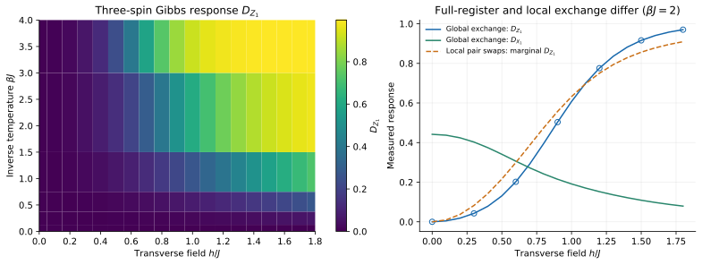

# Physical problems and worked examples

The central use case is learning a context-dependent nonlinear property of **repeatedly preparable quantum states**. Start with the question that matches your experiment, then use the derivations and original records below.

| Physical question | Focused guide | Evidence status |
|---|---|---|
| Which local noise direction erodes purity? | [Directional decoherence](applications/decoherence.md) | Trained held-out benchmark; known-law finite-time transfer |
| What do local marginals miss? | [Correlations and parity](applications/correlations.md) | Verified circuit identity; stronger known parity comparator |
| How does this response relate to phase sensitivity? | [Sensing and sub-QFI](applications/metrology.md) | Verified identity and independent QFI calculations |
| How do field and temperature alter a small spin register? | [Thermal spins](applications/thermal-spins.md) | Illustrative three-spin diagnostic |
| Could conditional response estimates guide a new experiment? | [Open-system characterization](applications/open-system-control.md) | Proposed research extension |
| Does my problem fit this access model? | [Problem selection](applications/choosing-a-problem.md) | Implementation decision guide |

The [evidence matrix](evidence.md#application-and-resource-evidence-matrix) separates feature representation, predictive error, copy cost, gates, and hardware evidence. The following original sections retain their URLs and equation details for existing links.

The main target is the sensitivity of a quantum state to a chosen dephasing direction. It connects the exchange feature map to decoherence, correlations, finite-time purity decay, and parameter sensitivity. These connections provide concrete tests with known answers and clear resource comparisons.

The examples distinguish three uses of the code: a trained predictor, an analytic exchange circuit, and a mathematical identity evaluated independently. A verified identity on a larger state is useful evidence about implementation and physical scope; it does not establish that a network has learned that larger problem.

## 1. Directional dephasing response

Let \(P=P^\dagger\) and \(P^2=I\). For two qubits, the benchmark uses

$$
P_c=(n_xX+n_yY+n_zZ)\otimes I,\qquad
\mathbf n=(\sin\theta\cos\varphi,\sin\theta\sin\varphi,\cos\theta).
$$

Consider the Markovian dephasing generator

$$
\dot\rho=\gamma(P\rho P-\rho),\qquad\gamma\geq0.
$$

Its instantaneous effect on purity is determined by

$$
\begin{aligned}
D_P(\rho)
&=\operatorname{Tr}(\rho^2)-\operatorname{Tr}(\rho P\rho P)\\
&=\tfrac12\|[P,\rho]\|_{\mathrm{HS}}^2,\\
\frac{d}{dt}\operatorname{Tr}(\rho^2)&=-2\gamma D_P(\rho).
\end{aligned}
$$

The normalization gives \(0\leq D_P\leq1\). A state commuting with \(P\) has zero response. A state with coherence between the two eigenspaces can lose purity under this dephasing. Even when \(P\) acts on one spin, the response can depend on correlations with the other spins.

### Read the response with one exchange

Apply \(V=e^{-i\pi P/4}\) to a fresh copy and use \(\eta=\pi/4,\chi=0\). At the terminal block, measure \(P\) on both outputs. With \(m=\operatorname{Tr}(P\rho)\),

$$
z_A=m-D_P/2,\qquad z_B=m+D_P/2.
$$

Their difference is \(D_P\). Joint outcomes \(s,t\in\{-1,1\}\) provide the estimator \(t-s\), using two source preparations per shot. This circuit implements the collective observable

$$
K_P=(I-P\otimes P)S
$$

exactly, including its grouped measurement distribution. The implementation makes the physical response accessible; the direct-\(K_P\) comparator has the same ideal statistics.

The trained benchmark learns a structured conditional circuit and affine head on independent physical state families. Its errors and strong competitors appear on the [evidence page](evidence.md), with the original [dataset manifest](assets/data/benchmark.json).

## 2. Bell and GHZ mixtures expose global correlations

For \(m\geq2\), define

$$
\begin{aligned}
|\mathrm{GHZ}^{\pm}\rangle
&=(|0\rangle^{\otimes m}\pm|1\rangle^{\otimes m})/\sqrt2,\\
\rho_t
&=t|\mathrm{GHZ}^+\rangle\langle\mathrm{GHZ}^+|
+(1-t)|\mathrm{GHZ}^-\rangle\langle\mathrm{GHZ}^-|.
\end{aligned}
$$

Every single-qubit marginal is \(I/2\), independently of \(t\). Nevertheless, for \(P=Z_1\),

$$
D_P(\rho_t)=(2t-1)^2.
$$

The two-qubit case is a Bell mixture. These families are an exact test of whether a representation retains relevant global correlations. Any model receiving only single-qubit marginals sees the same input for every \(t\).

The executed suite uses 41 mixture weights for each of two and three qubits, giving 82 cases. The prescribed exchange circuit agrees with the exact polynomial within \(6.67\times10^{-16}\). [Example checks](assets/results/physics_examples/checks.json) also verify the constant local marginals and the stronger Pauli comparator.



A fixed one-copy linear expectation is affine in \(t\), so it cannot reproduce the quadratic curve for every mixture. Under a continuous uniform distribution on \(t\in[0,1]\), the best affine predictor is the constant \(1/3\), with MSE \(4/45\). This is a restricted representation result, not a comparison against every classical measurement protocol.

### A strong classical estimator

The global Pauli expectation satisfies

$$
\langle X^{\otimes m}\rangle_{\rho_t}=2t-1.
$$

Measure this observable on two independent copies and multiply the signs. The product is an unbiased estimator of \(D_P\). With \(C=2N\) source copies,

$$
\begin{aligned}
\operatorname{Var}(\widehat D_{\mathrm{Pauli}})
&=(2-2D_P^2)/C,\\
\operatorname{Var}(\widehat D_{\mathrm{exchange}})
&=(4-2D_P^2)/C.
\end{aligned}
$$

The simple Pauli protocol has lower variance on this family. The example therefore supports using correlations beyond local marginals while also identifying a case where collective exchange is statistically inferior to a target-specific classical estimator.



## 3. Transfer an estimated response to finite-time purity loss

The same dephasing generator has the exact solution

$$
\rho_T=
\frac{1+e^{-2\gamma T}}2\,\rho+
\frac{1-e^{-2\gamma T}}2\,P\rho P.
$$

Its purity loss is

$$
\operatorname{Tr}(\rho^2)-\operatorname{Tr}(\rho_T^2)
=\frac{1-e^{-4\gamma T}}2\,D_P(\rho).
$$

A frozen prediction \(\widehat D_P\) can therefore answer queries for different times and rates:

$$
\widehat{\Delta\mathcal P}(T,\gamma)
=\frac{1-e^{-4\gamma T}}2\,\widehat D_P.
$$



The example applies this formula to the saved two-qubit predictor without retraining. It demonstrates reuse of a learned response under a known physical law. The temporal dependence comes from the analytic generator solution, so this is not evidence that the model learned unknown open-system dynamics.

The executed transfer uses 128 held-out state–context pairs, three rates \(\gamma=0.15,0.5,1.25\), and 21 times in \([0,3]\). Across 8,064 cases, purity-loss MSE is \(6.33\times10^{-13}\), with maximum absolute error \(3.35\times10^{-6}\). The [manifest](assets/results/physics_examples/manifest.json) identifies the frozen seed-31 checkpoint and independent channel/exponential checks.

The complete two-sector dephasing map is \((\rho+P\rho P)/2\). Its purity loss is \(D_P/2\), consistent with the \(T\to\infty\) limit for fixed \(\gamma>0\). Keeping this factor explicit prevents confusing the instantaneous response with the fully dephased purity difference.

## 4. Established sub-QFI as a parameter-sensitivity diagnostic

Suppose a parameter is encoded through

$$
\rho_\vartheta=e^{-i\vartheta P/2}\rho e^{i\vartheta P/2}.
$$

Quantum Fisher information describes the local distinguishability of this family under optimized measurement; its normalization and spectral formula follow [Paris, *Quantum estimation for quantum technology*](https://arxiv.org/abs/0804.2981).

For this generator, \(D_P\) is exactly the established **sub-quantum Fisher information** studied by [Cerezo, Sone, Beckey, and Coles](https://arxiv.org/abs/2101.10144). The example applies that existing sensitivity bound and its purity-loss connection.

Writing \(\rho=\sum_i\lambda_i|i\rangle\langle i|\), and omitting zero denominators,

$$
F_Q(\rho,P/2)=
\frac12\sum_{i,j}
\frac{(\lambda_i-\lambda_j)^2}{\lambda_i+\lambda_j}
|\langle i|P|j\rangle|^2.
$$

The exchange response has the corresponding expression without the denominator:

$$
D_P(\rho)=
\frac12\sum_{i,j}
(\lambda_i-\lambda_j)^2|\langle i|P|j\rangle|^2.
$$

For distinct eigenvalue indices, \(\lambda_i+\lambda_j\leq1\). Termwise comparison gives

$$
D_P(\rho)\leq F_Q(\rho,P/2).
$$

Equality holds for pure states and for every one-qubit state. Mixed states in larger dimensions can have a strict gap.

The suite covers 60 pure two-qubit states, 60 mixed qubit states, 100 mixed two-qubit states, and 41 depolarized Bell cases. The independent spectral and symmetric-logarithmic-derivative calculations agree within \(1.95\times10^{-15}\); see the [checks](assets/results/physics_examples/checks.json).



An accurately estimated \(D_P\) can thus provide a lower-bound diagnostic for this particular sensing generator. It does not determine the full Fisher-information matrix, select an optimal measurement automatically, or establish an entanglement advantage. A finite-shot or learned estimate also needs an uncertainty allowance before it can be used as a certified numerical bound.

## 5. Extend the operation to a three-qubit Gibbs state

The map is defined for any equal-size registers. For a coupled-spin Hamiltonian \(H\), a Gibbs input is

$$
\rho_\beta=e^{-\beta H}/\operatorname{Tr}(e^{-\beta H}).
$$

The three-qubit example varies the thermal state and evaluates a local directional dephasing response. It uses full register exchange and compares the resulting observable with an independently evaluated density-matrix functional.

The Hamiltonian is

$$
H=-J(Z_1Z_2+Z_2Z_3)-h(X_1+X_2+X_3)-\epsilon(Z_1-Z_3),
$$

with \(J=1\), \(\epsilon=0.13\), six inverse temperatures from 0 to 4, and nineteen fields from 0 to 1.8. Its 114 states are queried with both \(X_1\) and \(Z_1\).



The global-circuit response agrees with independent matrices within \(7.78\times10^{-16}\). A six-Fredkin construction is also checked. Replacing global exchange by independent local exchanges changes the response by up to \(0.0970\) on the sampled \(\beta=2\) fields. These are different physical circuits.

This is an analytic implementation extension; no three-qubit model is trained. The source states, sweep, and errors are recorded in the [manifest](assets/results/physics_examples/manifest.json).

## Run and adapt the examples

```bash
python examples/physics_examples.py
```

The script produces machine-readable results and scientific figures under `results/physics_examples/`. Each case identifies whether it uses the learned model or the exact analytic exchange construction. The [manifest](assets/results/physics_examples/manifest.json) and [21 passing checks](assets/results/physics_examples/checks.json) are the source for the plotted examples.

To adapt the physics, first state the preparation model, target observable or functional, context variables, and allowed measurements. Retain an exact small-system calculation while testing the proposed circuit. The relevant resource is repeated state preparation, not merely the number of rows in a classical training array.

## Further physical tasks to investigate

| Proposed task | Why exchange features may be useful | Evidence still needed |
|---|---|---|
| Direction-dependent noise diagnostics on larger registers | Conditional gates select a perturbation while global exchange accesses quadratic correlations | Scaling against optimal collective and measured-feature estimators |
| Learning several open-system response coefficients | Different context-selected commutators can supply a family of sensitivities | A dataset with multiple generators and new held-out response laws |
| Symmetry-aware state characterization | Compatible conditioner transformations can preserve useful covariance | Explicit symmetry constraints and comparison with equivariant alternatives |
| Quantum-memory processing of repeated preparations | Streaming layers retain a hidden state while new copies arrive | Deep supervised tests, source drift, and compiled noisy-circuit studies |

These are research directions rather than executed benchmark claims. The existing examples establish useful physical identities, a working conditional circuit, and specific limitations. A convincing advantage requires a task and access regime where the strongest practical alternatives leave room for improvement.
