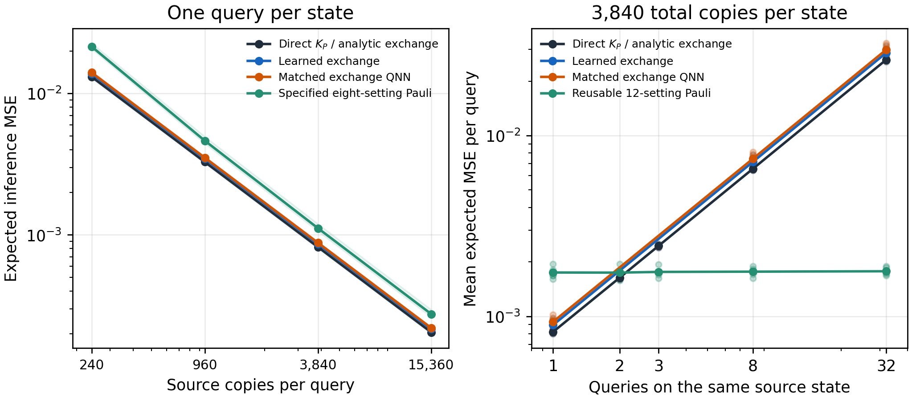
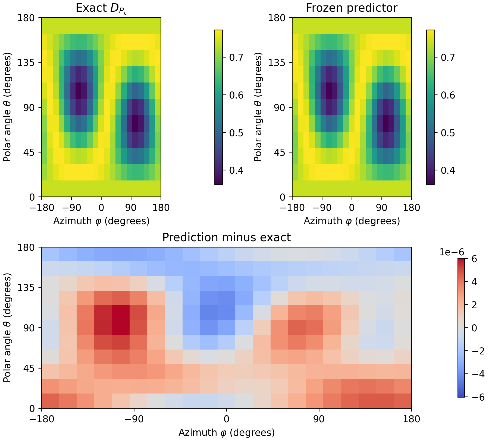

# QIP revision: physical-axis validation

This is the current five-dataset study behind the manuscript. The original single-dataset experiment remains in the repository as historical development evidence. Its oriented $n_x>0.55$ cap let antipodal *physical axes* appear in training. The revision excludes both caps $|n_x|>0.55$ from training and validation, and uses new states for the joint test. The [frozen protocol](assets/results/submission_revision/protocol.json) records the split and seeds.

The research tool has two parts. `ContextExchangeLayer` and `StreamingExchangeNetwork` expose a differentiable state-valued collision that can be stacked and trained. The paper's compact 25-parameter specialization fits the known directional-dephasing response with a task-aligned frame and affine two-port readout. These are related implementations with different scopes: the two-layer streaming trainer is a software integration fixture; the compact model supplies the measured learning results. See the [architecture](architecture.md) and [training guide](training.md).

Run the current frozen checkpoint on all 512 new-state/held-out-axis pairs without retraining:

```bash
python examples/qip_revision_inference.py --output /tmp/qem-qip-review
```

The command selects the checkpoint by validation MSE among the three fixed starts, checks its saved score, and writes predictions and a report. Pass `--dataset confirmation_2` through `confirmation_5` to inspect the other datasets, or `--input states.npz` with `rho[B,4,4]`, `angles[B,2]`, and optional `target[B]` arrays. [Inference code](https://github.com/zetanaut/quantum-exchange-modulation/blob/main/examples/qip_revision_inference.py).

## What was tested

Five independently generated confirmation datasets each contain 64 candidate training states, 16 validation states, and 128 new test states from three physical families. Each included training state contributes five contexts. The joint test uses four held-out-axis contexts per new state. Budgets of 8, 16, 32, and 64 states are nested within each dataset. Three optimizer starts are retained for every learned configuration. The quantum models use exact expectation training and validation-selected checkpoints; inference copy costs are assessed separately.

| Training states | Compact exchange MSE | Matched exchange QNN MSE | Product FiLM MSE | Fitted Gram-36 MSE |
|---:|---:|---:|---:|---:|
| 8 | $1.87\times10^{-6}$ | $1.53\times10^{-6}$ | $8.18\times10^{-2}$ | $1.82\times10^{-27}$ |
| 16 | $1.39\times10^{-8}$ | $1.51\times10^{-8}$ | $4.67\times10^{-2}$ | $1.95\times10^{-30}$ |
| 32 | $6.07\times10^{-9}$ | $1.04\times10^{-8}$ | $3.19\times10^{-2}$ | $2.41\times10^{-30}$ |
| 64 | $1.56\times10^{-9}$ | $1.75\times10^{-8}$ | $1.31\times10^{-2}$ | $1.19\times10^{-30}$ |

Values are means of the five dataset means; quantum and FiLM means also average three starts. Each budget uses 96 additional validation labels. The 36-feature model fits coefficients from training labels but receives the correct operator-product structure. Its near-zero error rules out a general learning-efficiency advantage on this analytic target. The [machine-readable summary](assets/results/submission_revision/summary.json) and [manuscript source](https://github.com/zetanaut/quantum-exchange-modulation/blob/main/paper/qip/quantum_exchange_modulation_paper.tex) give the full model definitions.


[Vector figure](assets/figures/qip_Fig2.pdf) · [Figure script](https://github.com/zetanaut/quantum-exchange-modulation/blob/main/paper/qip/redraw_learning.py)

## What the ablations show

The compact model learns reliably **from its task-aligned initialization** under the recorded optimizer schedule. With a neutral initialization, the mean joint-test MSE is $5.37\times10^{-2}$, close to the constant baseline $5.71\times10^{-2}$, while the median across 15 starts is $1.67\times10^{-6}$. Ten of 15 neutral starts reach validation MSE below the descriptive $10^{-4}$ threshold, versus all 15 aligned starts. This is optimization sensitivity, not an expressivity impossibility. The [per-start diagnostic](assets/results/submission_revision/reviewer_diagnostics.json) preserves every value.

The generic nonlinear source conditioner, with the known $P(c)$ readout, averages $5.47\times10^{-2}$ at 64 states. Equal-weight sign mixing, which removes the commutator from the compact layer, averages $5.89\times10^{-2}$. The paper reports the matched QNN, analytic port-head calibration, exact Gram construction, and fitted product-feature controls alongside these ablations.

## Copies and repeated queries

One exchange shot uses two independent source preparations and reads both ports jointly. At 3,840 copies for a single query, mean expected MSE is $8.63\times10^{-4}$ for the learned compact layer and $8.19\times10^{-4}$ for the analytic exchange circuit or direct collective $K_P$. The learned layer's mean squared bias is only $1.56\times10^{-9}$; its larger total error comes from its fitted two-port outcome variance. These are ideal inference laws following exact-expectation training.

When 3,840 total copies per state are shared across several axes, context-specific collective shots divide the budget between queries. A 12-setting Pauli record can be reused for every axis. The exploratory integer check on the frozen query pools puts the mean-risk crossover between **two and three queries**: direct $K_P$ is lower at two, and reused Pauli measurements are lower at three. This is a comparison of context-specific and reuse-aware estimators under the stated allocation; it is not a general quantum-versus-classical limit. [Break-even record](assets/results/submission_revision/amortization_break_even.json).



[Vector figure](assets/figures/qip_Fig4.pdf) · [Figure script](https://github.com/zetanaut/quantum-exchange-modulation/blob/main/paper/qip/redraw_copies.py)

## Transfer checks and source

A validation-selected checkpoint from confirmation dataset 1 is evaluated on 128 new states with held-out axes. Inserting its predicted response into the **known** dephasing time law gives 8,064 purity-loss values with MSE $6.27\times10^{-13}$. The same checkpoint produces the one-state exploratory direction map below with MSE $6.05\times10^{-12}$. That map includes training-region axes, so it is a visualization rather than a population holdout test. [Finite-time record](assets/results/submission_revision/transfer_checks/finite_time.json) · [Map CSV](assets/results/submission_revision/transfer_checks/directional_response_map.csv).



[Vector figure](assets/figures/qip_Fig3.pdf) · [Figure script](https://github.com/zetanaut/quantum-exchange-modulation/blob/main/paper/qip/redraw_direction.py)

The manuscript source, Springer class, bibliography style, bibliography, and figures are under [`paper/qip/`](https://github.com/zetanaut/quantum-exchange-modulation/tree/qip-revision-v1/paper/qip). The full datasets, checkpoints, and per-start records are under [`results/submission_revision/`](https://github.com/zetanaut/quantum-exchange-modulation/tree/qip-revision-v1/results/submission_revision). The source uses pdfLaTeX and BibTeX. Tag `qip-revision-v1` identifies this frozen public version.

From a Python 3.12 environment installed per the [installation guide](install.md), the focused checks are:

```bash
python scripts/run_all.py
python scripts/submission_validate_datasets.py
python scripts/submission_validate_checkpoints.py
python scripts/submission_generic_checks.py
python scripts/submission_reviewer_diagnostics.py
python scripts/submission_transfer_refresh.py
python scripts/submission_break_even.py
python scripts/submission_release_gate.py
python scripts/verify_qip_paper_sources.py
```

The [reproduction guide](reproduction.md) explains which commands are checks and which regenerate fits. The source audit checks citation keys, cross-references, figures, and reported learning-curve values against the saved record; a pdfLaTeX/BibTeX build remains separate. The release gate checks completeness of the frozen record; it does not claim that CI retrains all 240 quantum and 480 classical confirmation fits. Finite-shot training, hardware noise, preparation cost, and large-register scaling remain untested.
