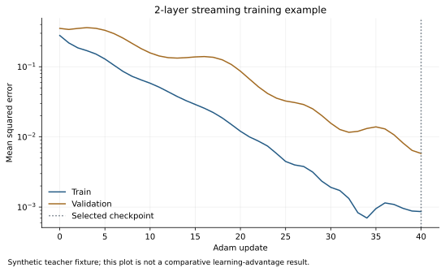

# Build a predictor and train it

The training workflow combines a classical loss with differentiable PennyLane circuits. There are two starting points: attach a readout to the general streaming network, or train the compact benchmark model whose readout and context geometry are already specified. The examples below assume the package is installed and commands run from the repository root.

## Choose the model that matches the question

| Goal | Starting point | Current evidence |
|---|---|---|
| Develop a new quantum hidden-state architecture | `StreamingExchangeNetwork` | Two-layer state/gradient checks and a small teacher–student example |
| Reproduce directional dephasing regression | `TorchQuantumModel("joint_exchange")` | Three seeded training runs and held-out tests |
| Test whether the primitive explains success | `TorchQuantumModel("exchange_matched_qnn")` | Same-exchange quantum comparator |
| Remove the commutator contribution | `TorchQuantumModel("no_commutator")` | Matched port-mean ablation |
| Compare measured classical features | `TorchFiLM` and Gram/kernel models | Ideal-feature fits and separate inference-cost analysis |

The generic classes return states. A supervised application supplies observables, a classical head, labels, and an evaluation split. A useful readout must make the desired target identifiable from the chosen measurements.

## A complete gradient path through two layers

The following code creates a tiny teacher–student task. Its purpose is to exercise composition and optimization; it is not the dephasing benchmark or a generalization experiment.

```python
import numpy as np
import torch
from qem.layers import StreamingExchangeNetwork

torch.set_default_dtype(torch.float64)
torch.set_num_threads(1)
torch.manual_seed(42)
data = np.load("data/benchmark.npz")
rho = torch.tensor(data["train_rho"][:4], dtype=torch.complex128)
context = torch.tensor(data["train_context"][:4])
observable = torch.tensor(data["train_P"][:4], dtype=torch.complex128)

teacher = StreamingExchangeNetwork(2, 3, hidden=8, depth=2)
with torch.no_grad():
    target = torch.einsum(
        "bij,bji->b", teacher(rho, context), observable
    ).real

student = StreamingExchangeNetwork(2, 3, hidden=8, depth=2)
optimizer = torch.optim.Adam(student.parameters(), lr=0.02)
for step in range(15):
    optimizer.zero_grad(set_to_none=True)
    output_state = student(rho, context)
    prediction = torch.einsum(
        "bij,bji->b", output_state, observable
    ).real
    loss = ((prediction - target) ** 2).mean()
    loss.backward()
    optimizer.step()
print(float(loss.detach()), student.copies_per_execution)
```

`python scripts/quickstart.py` runs the packaged version and prints its history. Four examples and fifteen updates demonstrate a working training path. The [layer verification report](assets/results/verification/layer_checks.json) separately checks the exact state map and a two-layer directional gradient.

For a classical head \(h_\psi\), the general loss is

$$
z_j=\operatorname{Tr}[O_j(c)\omega_L],\qquad
\widehat y=h_\psi(\mathbf z,c),\qquad
\mathcal L=\frac1B\sum_i\ell(\widehat y_i,y_i).
$$

Torch applies the chain rule through the head, later memory updates, quantum operations, and context network. Earlier layers receive gradients that include their effect on the complete subsequent computation.

## Load and use the trained specialization

The benchmark interface takes two-qubit states and angles ordered as \((\theta,\varphi)\). The generic conditioner instead accepts a configured context vector; the default dataset supplies the three-component direction \(\mathbf n\).

```python
from qem.pennylane_models import TorchQuantumModel

weights = np.load("results/torch_quantum/weights.npz")
model = TorchQuantumModel(
    "joint_exchange",
    initial_parameters=weights["joint_exchange__selected"],
)
angles = torch.tensor(data["test_joint_angles"][:8])
test_rho = torch.tensor(
    data["test_joint_rho"][:8], dtype=torch.complex128
)
with torch.no_grad():
    raw = model(test_rho, angles)
print(raw["prediction"])
print(raw["heads"].shape, raw["correlation"].shape)
```

The correlation is the expectation of the product of the two commuting port observables. It is retained to calculate joint-shot uncertainty. The prediction head uses only the two means and a bias.

`python examples/pretrained_inference.py` runs the saved checkpoint and writes predictions. Its `--input custom_inputs.npz` option accepts `rho[B,4,4]`, `angles[B,2]`, and an optional `target[B]` array.

All learned quantum operations execute inside actual PennyLane QNodes. The fast benchmark backend purifies the supplied mixed input into four data wires and four untouched simulator environment wires. The environment represents mixedness; the learner neither reads it nor uses it as a feature source.

## Reproduce the quantum fits

These commands place new runs in separate directories:

```bash
python scripts/train_torch.py \
  --models joint_exchange,no_commutator,exchange_matched_qnn \
  --seeds 17,31,73 \
  --maxiter 120 \
  --batch-size 320 \
  --val-every 5 \
  --output results/rerun_torch_quantum
```

The default optimizer is Torch L-BFGS with a strong-Wolfe line search. The objective is the full training-set mean-squared error. When a smaller batch size is selected, gradients accumulate over all chunks before an optimizer update. The optional Adam warm-up is controlled by `--adam-steps` and `--adam-lr`; the recorded primary runs used no warm-up. Initializations are seeded random starts, not previously fitted NumPy parameters. [Training records](assets/results/torch_quantum/metrics.json) include validation checkpoints, objective evaluations, stopping reasons, timings, and final scores.

Both quantum families receive the same directional-frame prior: scales start near one and offsets near zero, with seeded perturbations.

The trainable angles remain physical for real parameter values. The optimizer still faces redundant parameterizations. In the exact dephasing construction, the interpolation coefficient can disappear from the selected mean, and a commutator gain can be absorbed into the output head. Fitted parameters therefore need additional identification tests before they are interpreted as estimated physical constants.

## Split states and contexts explicitly

The recorded [dataset manifest](assets/data/benchmark.json) contains 320 training pairs from 64 source states and 96 validation pairs from 16 other states. The primary test combines 32 further states with directions in the excluded spherical cap \(n_x>0.55\), giving 128 examples. Separate tests isolate state and context transfer.

State–context pairs sharing a density matrix are not independent new quantum states. Split by source-state identity when testing state generalization. For contextual transfer, hold out a region of directions rather than merely shuffling rows.

The sources come from coupled-spin Gibbs states, driven product mixtures, and noisy low-rank preparations. Generator parameters are excluded from model inputs. Exact density matrices initialize the simulator; in a physical experiment they would be replaced by repeatable state preparations. Exact training labels are another benchmark assumption, and their acquisition cost must be specified for a hardware study.

## Give classical comparators meaningful optimization

The classical FiLM sweep uses fifteen nonidentity Pauli expectations and the context direction:

```bash
python scripts/train_torch_classical.py \
  --seeds 17,31,73 \
  --widths 12,24 \
  --l2 0.00001,0.001,0.01 \
  --steps 180 \
  --output results/rerun_torch_classical
```

Width and regularization are selected by mean validation MSE across seeds; checkpoint and displayed seed selection also use validation. The saved primary choice is width 12 and \(L_2=10^{-5}\), with 277 parameters. The complete [configuration sweep](assets/results/torch_classical/metrics.json) remains available.

Also include the target-informed six-feature Gram model, quadratic product kernel, and same-exchange QNN. Their roles differ: the Gram model encodes the known functional exactly, while the kernel and generic learned models test how well broader representations fit finite data. A poor FiLM result alone is insufficient evidence for quantum advantage.

## Vary the number of training states

```bash
python scripts/learning_curve.py --output results/learning_curve_reproduction
```

The state-budget study uses nested sets of 8, 16, 32, and 64 complete source states, with five context pairs per state. Each size uses optimizer seeds 17, 31, and 73, fixed validation and test sets, and a balanced source-family ordering. It reruns the classical configuration sweep at each budget. The 64-state endpoint reuses the verified matching primary runs with provenance.

The horizontal axis counts training states and pairs. Every budget additionally uses the fixed 96 validation pairs: the smallest point uses 40 training pairs plus 96 validation pairs. This is not a total-label or shot-complexity experiment.

The protocol measures optimizer variability for one declared nested sequence, rather than variability across resampled datasets. At reduced budgets, the original context-only test may also contain omitted training states. Consult the [protocol](assets/results/learning_curve/protocol.json) and [results](assets/results/learning_curve/metrics.json). Use `--resume` to continue the chosen output directory or `--plot-only` to rebuild its charts.

## Train and checkpoint a custom streaming predictor

The [streaming trainer](assets/code/examples/train_streaming.py) attaches selected Pauli expectations and an affine Torch head through `StreamingObservableRegressor`. Its default synthetic teacher fixture exercises training, validation selection, checkpointing, and reloading:

```bash
python examples/train_streaming.py --output results/streaming_reproduction
```



This is a software integration example, separate from the physical advantage comparisons. For your own labeled physics data:

```bash
python examples/train_streaming.py \
  --dataset my_physics.npz --n-qubits 2 --context-dim 3 \
  --depth 2 --hidden 8 --observables ZI,IZ,XX \
  --steps 100 --output results/my_physics_run
```

The NPZ must contain `train_rho`, `train_context`, `train_y` and the corresponding `validation_*` and `test_*` arrays. State shapes are \((B,d,d)\), context shapes \((B,q)\), and scalar targets \((B,)\) or \((B,1)\). Optional `*_state_id` arrays are checked for disjoint identities across splits. Supply valid normalized density matrices and exclude hidden preparation labels from the context.

The lowest-validation-MSE checkpoint is saved as `weights.pt`. It stores configuration and tensor state, not a pickled quantum device:

```python
from qem.predictors import load_predictor

torch.set_default_dtype(torch.float64)
saved = np.load("results/streaming_reproduction/dataset.npz")
restored = load_predictor("results/streaming_reproduction/weights.pt")
with torch.no_grad():
    predictions = restored(
        torch.tensor(saved["test_rho"], dtype=torch.complex128),
        torch.tensor(saved["test_context"]),
    )
```

The trainer records selected-step metrics and exact checkpoint-reload agreement. Distinct Pauli bases require separate physical measurement settings, each repeating the full streaming preparation cost.

## Evaluate measurement noise after training

```bash
python scripts/finite_shot_benchmark.py \
  --quantum results/rerun_torch_quantum \
  --classical results/rerun_torch_classical \
  --copies 240,960,3840,15360 \
  --replicates 512 \
  --output results/rerun_finite_shot
```

This evaluates finite-shot **inference after exact-expectation training**. Quantum affine heads use exact mean/variance formulas including port covariance. The target-informed Pauli comparator uses unbiased squared-mean estimators. FiLM receives independently sampled Pauli-feature estimates and is evaluated by Monte Carlo.

A future shot-trained experiment must account for noisy losses, gradient estimation, label acquisition, and validation selection. A depth-\(L\) streaming circuit needs \(L+1\) preparations per execution, multiplied by shots and measurement settings. Gradient circuits add executions. Dense simulator backpropagation provides none of those measurements for free.

Run `python scripts/run_all.py` to check the mathematical identities, actual QNodes, and reusable layer before changing the architecture. Preserve the same strong comparisons when extending it to a new physical target.
